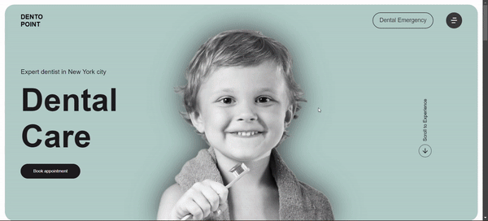
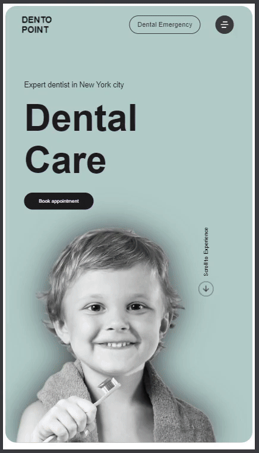

# 🦷 Pearl Avenue — Modern Dental Care & Clinic Website

<p align="center">
  
  
</p>

<p align="center">
  <strong>Premier dental healthcare, modern dentistry, and 24/7 emergency dental care in New York City.</strong>
</p>

---

## 📌 Overview

**Pearl Avenue** is an elegant, fully responsive modern dental clinic website built with clean HTML5, modern CSS3, and vanilla JavaScript. The site provides prospective and returning patients with an immersive, intuitive experience to explore dental treatments, discover advanced clinical technology, read verified patient reviews, access primary and alternative emergency contact channels, and book online appointments seamlessly.

---

## 🏷️ Brand Identity

* **Brand Name:** Pearl Avenue
* **Tagline:** Expert Dental Care on Pearl Avenue, NYC
* **Specialization:** General, Cosmetic, Restorative, Orthodontic & 24/7 Emergency Dentistry

---

## 📞 Official Contact & Alternative Details

Pearl Avenue provides multiple direct and alternative contact channels to ensure patients can reach dental specialists at any time, especially during emergencies:

| Channel | Primary Detail | Alternative / Emergency Detail |
| :--- | :--- | :--- |
| **Phone** | [`+1 (212) 555-0198`](tel:+12125550198) *(Appointments & Inquiries)* | [`+1 (212) 555-0144`](tel:+12125550144) *(24/7 Emergency Line)* |
| **Email** | [`contact@pearlavenue.com`](mailto:contact@pearlavenue.com) *(General)* | [`care@pearlavenue.com`](mailto:care@pearlavenue.com) *(Urgent Records & Support)* |
| **Location** | `120 Pearl Avenue, Suite 400, New York, NY 10005` | `45 Water St` *(Valet & Accessible Entrance)* |
| **Working Hours** | Mon – Fri: `8:00 AM – 7:00 PM` <br> Sat: `9:00 AM – 4:00 PM` | Sunday & Holidays: `24/7 On-Call Emergency` |

> [!IMPORTANT]
> **Emergency Care:** The top navigation bar features a direct one-click emergency dial button ([`Emergency: (212) 555-0144`](tel:+12125550144)) to immediately connect patients experiencing acute dental pain or trauma with on-call specialists.

---

## ✨ Key Features

1. **Brand Hero & Navigation:**
   - Animated **Pearl Avenue** brand logo.
   - Quick **Emergency Contact** hotline button right in the header.
   - Smooth slide-out mobile drawer menu with quick contact details.
   - Direct CTA to appointment booking.

2. **About Pearl Avenue Clinic:**
   - Highlights clinic philosophy, hygiene standards, patient-first care, and specialized dentists.
   - Trust indicators with patient avatar circles.

3. **Specialized Dental Services:**
   - **General Dentistry:** Routine checkups, digital cleanings, cavity fillings, and preventive care.
   - **Cosmetic Dentistry:** Teeth whitening, porcelain veneers, and smile makeovers.
   - **Restorative Dentistry:** Dental implants, dental crowns, bridges, and restorations.
   - **Emergency Care:** Rapid-response acute care for toothaches, fractures, and trauma.

4. **Modern Technology Showcase:**
   - Highlights cutting-edge dental innovations, digital 3D imaging, pain-free anesthesia, and cozy patient suites.

5. **Patient Testimonials & Reviews:**
   - Verified feedback from patients and senior doctors highlighting patient trust and comfort.

6. **Interactive Online Booking with Alternative Contact Details:**
   - Input fields for **Full Name**, **Primary Email**, and **Primary Contact Number**.
   - Dedicated **Alternative Contact Detail** field (Phone or Secondary Email) to ensure the clinic can reach patients if the primary number is unreachable.
   - Service selection dropdown & date/time picker.
   - Real-time client-side submission confirmation with appointment summary.

7. **Dedicated Contact & Alternative Information Panel:**
   - Clean card-based layout featuring primary contact, 24/7 alternative emergency line, primary email, urgent care email, clinic address, and alternative accessible entrance.
   - Interactive quick-action buttons: *Call Primary*, *Call Emergency*, and *Email Us*.

---

## 📁 Project Structure

```text
Pearl-Avenue/
│
├── index.html              # Main website markup with Pearl Avenue branding & contact panels
├── README.md               # Project documentation & website guide
├── cursor.png              # Custom cursor asset
│
├── assets/                 # Imagery, banners, icons, and walkthrough gifs
│   ├── back.jpg
│   ├── background.jpg
│   ├── candid.jpg
│   ├── Dental_Implant.jpg
│   ├── Dentist.jpg         # Specialist doctor feature image
│   ├── gif1.gif            # Walkthrough preview gif 1
│   ├── gif2.gif            # Walkthrough preview gif 2
│   ├── landing.png         # Hero banner image
│   ├── medical.png
│   ├── patient.avif
│   └── PATIENT.jpeg
│
└── src/
    ├── style.css           # Desktop & core styling, CSS variables, contact cards & form design
    ├── mobile.css          # Responsive layouts for tablet (<999px) and mobile (<679px)
    └── script.js           # Navigation drawer toggles & appointment form validation handler
```

---

## 🚀 Getting Started

### 1. Prerequisites
No build tools, package managers, or compilers are required. The website runs natively in any standard modern web browser.

### 2. Running Locally

#### Method A: Direct Browser Launch
Simply double-click `index.html` or open it with your favorite browser:
```powershell
Start-Process "index.html"
```

#### Method B: Local Development Server (Recommended)
You can use any lightweight local web server for smooth anchor scrolling and font loading:

* **Using Python 3:**
  ```bash
  python -m http.server 8000
  ```
  Then open `http://localhost:8000` in your browser.

* **Using VS Code Live Server:**
  Right-click `index.html` and select **"Open with Live Server"**.

* **Using Node `npx serve`:**
  ```bash
  npx serve .
  ```

---

## 🎨 Color Palette & Typography

* **Sage Mint Teal (Primary Accent):** `#afc9c8`
* **Dark Charcoal (Typography & Contrast):** `#3a3a3a`
* **Deep Navy (Buttons & Hero Brand):** `#232946`
* **Emergency Amber / Coral:** `#d9534f` / `#f2994a`
* **Background Light:** `#ffffff` / `#f7faf9`
* **Font Family:** Modern Sans-Serif (`system-ui`, `-apple-system`, `sans-serif`)
* **Iconography:** [Remix Icon](https://remixicon.com/) (loaded via CDN)

---

## 📱 Responsive Breakpoints

* **Desktop:** `> 1000px` (Two-column contact & booking layout, split hero)
* **Tablet:** `max-width: 999px` (Stacked page layouts, full-width cards)
* **Mobile:** `max-width: 679px` (Optimized header padding, single-column booking form, compact emergency hotline badge, full-screen mobile menu drawer)

---

## 📋 Appointment Booking Fields

The booking form accepts the following patient details:

| Field Name | Type | Requirement | Description |
| :--- | :--- | :--- | :--- |
| `name` | Text | Required | Patient's full name |
| `email` | Email | Required | Primary email for booking confirmation |
| `phone` | Tel | Required | Primary phone number for appointment verification |
| `alt_contact` | Text | Optional | Alternative contact number or email for backup communication |
| `service` | Select | Required | Selected dental specialty (General, Cosmetic, Restorative, Emergency, etc.) |
| `date` | Date | Required | Desired appointment date |
| `time` | Time | Required | Desired appointment time slot |
| `message` | Textarea | Optional | Dental symptoms, notes, or patient concerns |

---

## 📄 License & Credits

* **Brand & Clinic:** Pearl Avenue Dental Clinic
* **Copyright:** © 2024 Pearl Avenue Dental Clinic. All rights reserved.
* **Icons:** [Remix Icon CDN](https://cdn.jsdelivr.net/npm/remixicon@4.3.0/fonts/remixicon.css)
* **Images:** Unsplash & Project Assets
